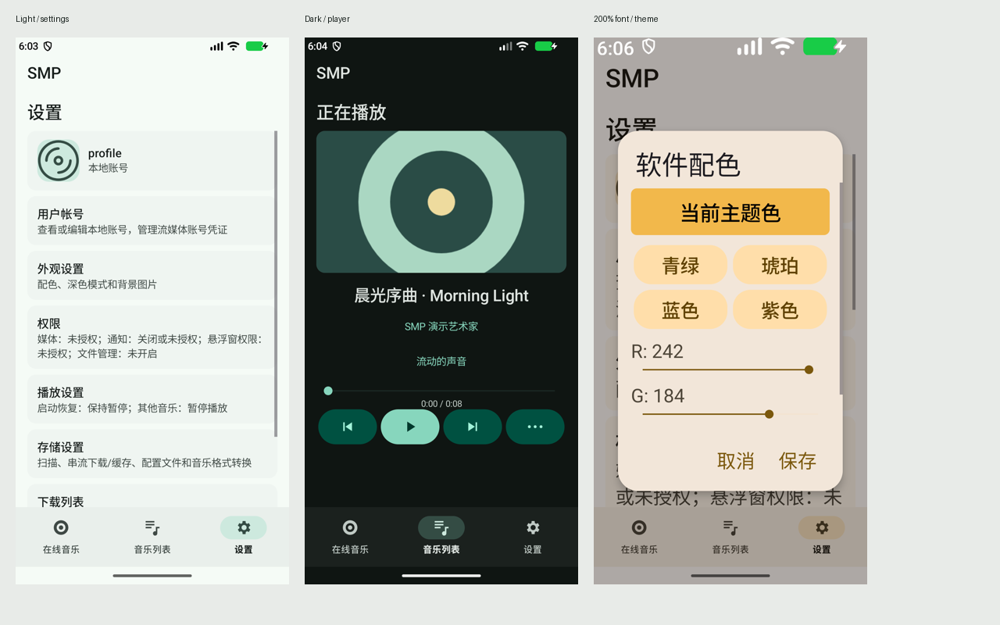

# MD3 视觉验收

验收版本：`2.1.0-beta.2`，versionCode `30`，隔离调试包 `com.supermite.smp.debug`。日期：2026-10-29。

## 结果与产物

本次以 Material 3 的颜色角色、字体层级、容器、输入、按钮、导航和对话框统一播放器界面。手机使用底部导航，600dp 及以上使用导航轨，低高度窗口使用紧凑播放条，宽屏播放页使用双栏。原有主题设置、播放、来源切换、队列和下载入口继续复用。

- [设计规则与官方参考](design-system.md)
- [逐截图配置、SHA-256 和尺寸检查数据](acceptance-data.json)
- [APK](../../release-artifacts/SMP-2.1.0-beta.2-md3-debug.apk)（本地构建产物，调试签名）
- [完整原始证据包](../../release-artifacts/SMP-2.1.0-beta.2-md3-visual-evidence.zip)（本地构建产物）

APK SHA-256：`3b58349ecb046897a1057aa2e5d886f4ca8a1d7a958a86fa70b232a559ab77e2`。各组截图均绑定该 APK，汇总脚本会拒绝混入其他构建的报告。



## 配置矩阵

工具链使用 `D:\Android\Android Studio\jbr` 与 `D:\Android\SDK`。Medium_Phone 模拟器实际系统为 Android API 37；应用 compileSdk 36、targetSdk 35、minSdk 26。尺寸为模拟器报告的 dp，字体使用 Android 系统缩放。

| 运行组 | 尺寸 dp | 字体 | 配色 | 截图 |
|---|---:|---:|---|---:|
| final-light | 375 × 750 | 100% | 青绿 / 浅色 | 79 |
| final-dark | 375 × 750 | 100% | 青绿 / 深色 | 79 |
| final-large | 375 × 750 | 200% | 琥珀 / 浅色 | 79 |
| final-small | 320 × 640 | 100% | 青绿 / 浅色 | 27 |
| final-landscape | 750 × 375 | 100% | 青绿 / 深色 | 27 |
| final-tablet | 800 × 1280 | 100% | 青绿 / 浅色 | 27 |
| final-tablet-landscape | 1280 × 800 | 100% | 青绿 / 深色 | 27 |

主矩阵共 **345 张真实截图、79 种页面/状态**，每组页面操作错误为 0。小屏组还在系统动画倍率 1 下执行，其他组遵循模拟器原来的减少动画配置。

另在 375 × 750dp / 200% 字号，以及 750 × 375dp / 100% 字号下执行 `scroll-large`、`scroll-landscape` 两组，各 21 张截图，均为 0 错误。最终证据共 **387 张截图**，不包含额外手动截图。补查先等待布局稳定，再滚动内容/操作区，并验证目标完整可见；避免把布局尚未完成或滚动边缘的临时状态当作固定裁切。

## 页面覆盖与人工复核

| 范围 | 已覆盖内容 |
|---|---|
| 本地音乐 | 播放列表、歌单详情、音乐库、搜索筛选、批量操作、空音乐库、扫描页 |
| 播放 | 完整播放页、迷你播放器、队列、播放模式、倍速、音量、歌曲菜单与详情 |
| 在线音乐 | Subsonic 首页、搜索、艺术家、歌曲、专辑、歌单，以及艺术家/专辑/歌单详情 |
| Dizzylab | 音乐首页、专辑、账户主页、关注动态、关注列表、未登录与加载失败状态、CDK 表单及行内错误、WebView 原生外壳 |
| WebDAV | 来源页、目录浏览、服务器管理及编辑 |
| 外观与账户 | 本地账户、头像、流媒体账号凭证、主题色、深色模式、背景与透明度 |
| 设置与编辑 | 权限、通知、播放、均衡器及预设、悬浮歌词、存储、扫描目录、缓存上限、输出目录、配置、下载列表、软件详情、更新、说明、首次启动，以及歌单/曲目/音频元数据/服务器编辑表单 |

通过联系表检查布局和配色一致性，再放大检查文字、选中标记、表单错误和触控控件。最终复核重点包括横屏列表、双栏播放、200% 字号、键盘弹出和主题切换后的常驻播放器。

代表性原图：[浅色设置](screenshots/light-settings.png)、[深色设置](screenshots/dark-settings.png)、[浅色播放](screenshots/light-playing.png)、[深色播放](screenshots/dark-playing.png)、[大字号主题](screenshots/large-theme.png)、[大字号筛选](screenshots/large-library.png)、[行内错误](screenshots/dark-input-error.png)、[单选状态](screenshots/dark-choice.png)、[平板导航轨](screenshots/tablet.png)、[横屏双栏](screenshots/landscape.png)。

## 发现并修复的问题

| 问题 | 修正与复核 |
|---|---|
| 原有渐变横幅、非统一按钮/图标与紧凑输入框 | 使用语义表面、Material 按钮、24dp 矢量图标、持久标签和行内错误；按钮触控目标按 48dp 设置 |
| 深色对话框的单选/复选标记不清晰 | 采用 AppCompat Activity 与 Material 对话框，显式配对选中颜色；浅/深色原图复核 |
| 200% 字号被固定高度裁切 | 输入及按钮随内容增长，主题预设改为两列，表单和操作条支持滚动 |
| 横屏导航及播放条压缩列表 | 改为导航轨、紧凑播放器及低高度歌单工具栏；完整播放页采用双栏 |
| 评分条拉伸后显示额外星形 | 评分条以内容宽度布局，保留五颗星和原有保存逻辑 |
| 主题编辑取消会留下预览颜色 | 将预览种子与已保存种子分离；自动验证取消和保存 |
| 深色/主题切换后常驻播放条局部保留旧色 | 同步刷新时间、进度、按钮和导航反馈颜色 |
| 歌词描边预览持续触发重绘 | 绘制时不再调用文本颜色 setter；保留描边、透明度和字号设置 |

## 回归结果

- JVM 单元测试 **19 项通过**：17 项 Dizzylab API 回归，2 项 MD3 颜色测试。颜色测试包含黑白、饱和色和用户预设的浅/深色组合，验证常用文字/表面颜色对的对比度至少为约 4.5:1。
- Android Lint **0 个错误、173 个警告**。保留完整报告于 `app/build/reports/lint-results-debug.html`；警告未被一概忽略，也不等于完整无障碍认证。
- 每个主矩阵运行均实际点击播放和暂停并检查播放器状态，验证返回导航链。完整组还检查主题取消/保存、主题色持久化、深色及跟随系统枚举、播放器同步着色、背景透明度保存和 CDK 空输入错误。
- 额外手动切换模拟器系统夜间模式，确认“跟随系统”在实际浅/深色配置变化后生效；200% 字号完整播放页滚动后四个操作按钮均完整显示，目标至少 48dp。
- 两组滚动补查通过：播放控制、WebDAV/Subsonic 来源页、横向批量操作栏、五类长设置/编辑表单均可滚动访问；大字号下 Material 对话框操作区也可独立滚动。实际注入触摸事件点击第五颗星、点击保存后检查库中评分为 5，并验证自定义头像 URI 保存及显示。[播放控件](screenshots/large-playing-scrolled.png)、[横向操作栏](screenshots/large-actions-scrolled.png)、[表单底部](screenshots/large-server-bottom.png)、[五颗星](screenshots/large-rating-five.png)、[自定义头像](screenshots/custom-avatar.png)、[横屏来源页](screenshots/landscape-source-scrolled.png)。
- APK 已通过 `apksigner verify`（v2 签名），包版本与 versionCode 已用 `aapt dump badging` 核对。

尺寸扫描保留所有提示，不把“成功截图”当作视觉合格。两处 `smallTargets` 提示来自列表滚动边缘的部分行；`edgeClippedTargets` 还记录了长表单、横向工具条及大字号播放页的滚动边界。必须结合滚动后的截图判断；边缘露出部分内容与固定布局裁切分别处理。

在已覆盖的原生界面中，复核未留下阻断使用的固定遮挡、不可达操作或主题切换着色问题。长标题采用省略号或换行；小窗口/大字号允许纵向滚动，批量操作栏允许横向滚动。

## 复现

```powershell
.\tools\android.ps1 -Task Audit -UseSystemProxy
.\tools\android.ps1 -Task Emulator
.\tools\visual-audit.ps1 -Theme light -Scope full -RunName final-light
# 依据矩阵设置 wm size / wm density / font_scale 后运行其余组。
# 额外滚动可达性检查：-Scope scroll
python tools/summarize-visual-audit.py
```

测试使用隔离的 `.debug` 包、合成 WAV、封面、歌曲、账户和服务器数据；不使用个人凭证，不下单、不兑换真实 CDK。它会改写调试包测试数据，应在专用模拟器运行。正式包数据不参与验收。截图原图及逐组报告位于 `build/visual-audit/`，精选截图和校验数据随源码保留。

## 验收边界

本次对列出的原生界面和状态完成视觉复核；共享的确认、错误和列表组件沿用相同 Material 样式。Dizzylab 网站正文、Android 文件选择器及系统权限页面由网站或系统控制，播放器覆盖其原生外壳。消息、订单、付费购买继续使用既有站内 WebView；没有增加原生付费购买功能。

此阶段验证 UI 与现有代码路径的兼容性，没有重新执行真实服务器的购买、下载或账户写操作。API 26–36 的每个系统版本、所有设备厂商字体、TalkBack 全流程及任意图片/颜色组合不在本轮实机覆盖范围内；报告不声称对所有可能状态或设备作出认证。颜色算法访问集中在 `Md3Colors`，Material Components 固定为 1.14.0，升级依赖时应重跑对比度和视觉验收。
