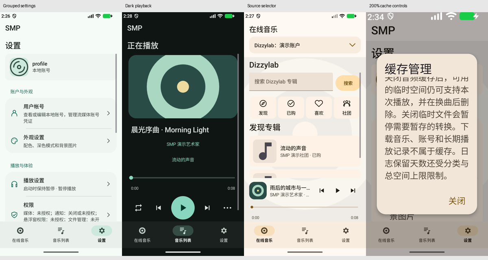

# 本轮视觉与功能验收

版本 `beta-2.0.0-20261030`，versionCode `31`。验收日期：2026-10-30。发布包名 `com.supermite.smp`；视觉与合成测试使用独立包 `com.supermite.smp.debug`。

本轮统一设置和播放界面的 MD3 表现，并实现分类缓存、诊断、记录持久化、NCM 系统媒体登记和日期频道更新。验收覆盖播放器自己的界面；WebView 内容和系统文件/权限选择器由提供方控制。

## 证据绑定

- [逐图 SHA-256、尺寸与行为断言](acceptance-data.json)
- [NCM、歌曲记录与日志设备 smoke 详情](smoke-data.json)
- [版本与签名规则](../release-policy.md)、[缓存/日志/歌曲记录规则](../cache-and-diagnostics.md)
- [基础 MD3 设计规则](../md3/design-system.md)与[上一轮历史报告](../md3/visual-acceptance.md)
- [本版本 GitHub 预发行与完整附件](https://github.com/SuperMite233/Simple-Music-Player/releases/tag/beta-2.0.0-20261030)

验收调试 APK SHA-256：`23a3ed262a72cf57afc9809e2a3c739082d552a8b86950eb68759f94b8aa7bbb`。发布 APK 的最终 SHA-256、签名、源码提交由附件 `SMP-release.json` 和 `SHA256SUMS.txt` 绑定；源码 ZIP 来自同一发布提交。测试包和发布包只在包名隔离/签名与构建元数据方面不同，不将调试 APK 作为发布安装包。



## 实际矩阵

工具链：`D:/Android/Android Studio/jbr`、`D:/Android/SDK`；Medium_Phone，实际 Android API 37。compileSdk 36 / targetSdk 35 / minSdk 26。下列数字来自模拟器真实资源配置。

| 运行组 | dp | 字体 | 初始主题 | 不同截图 | 行为断言 |
|---|---:|---:|---|---:|---:|
| refresh-light | 375 × 750 | 100% | light | 103 | 18 |
| refresh-dark | 375 × 750 | 100% | dark | 103 | 18 |
| refresh-large-accepted | 375 × 750 | 200% | amber | 103 | 18 |
| refresh-small | 320 × 640 | 100% | light | 27 | 0 |
| refresh-landscape | 750 × 375 | 100% | dark | 27 | 0 |
| refresh-tablet | 800 × 1280 | 100% | light | 27 | 0 |
| refresh-tablet-landscape | 1280 × 800 | 100% | dark | 27 | 0 |
| scroll-refresh-large | 375 × 750 | 200% | amber | 25 | 4 |
| scroll-refresh-landscape | 750 × 375 | 100% | dark | 25 | 4 |
| refresh-compact-controls | 750 × 375 | 100% | dark | 24 | 18 |
| refresh-large-actions | 375 × 750 | 200% | amber | 27 | 21 |

共 **518 张不同截图、101 项行为断言**；各组自动操作错误为 0。相同弹窗被重访时保留最后一张同名原图，统计按不同文件去重，不把重复捕获记录计为额外截图。每组保留对应测试 APK 的散列；补测只扩充测试代码，没有改变被测应用 APK。

light/dark 使用青绿种子，large 使用琥珀；全套过程还实际保存琥珀主题、切换浅/深/跟随系统并应用背景图，因此后续截图可能展示保存后的新主题。small 使用系统动画倍率 1，其余按减少动画的倍率 0；长标题在关闭动画时保持单行可读，动画启用时允许 marquee。

## 覆盖与结论

设置使用分组表面、图标、分隔线、可增长行高和滚动弹窗。原生 Material 3 开关、下拉、输入、选择和滑条统一配色；手机底部导航、宽屏导航轨以及低高度紧凑播放条均已复核。主题色编辑取消不写入，保存持久化；深色、跟随系统、背景图片及透明度保持有效。颜色角色测试覆盖十个种子的浅深配色，正文/on-color 对比度约 4.5:1 及以上；不把任意用户背景图片的对比度当作已认证结果。

迷你播放器外框已移除，细轨道保留 48dp 触控区；拖动不误切曲，音乐信息行横滑仍切曲。完整播放主动作 72dp，上一首/下一首及菜单不再套重复色块。长标题保持单行 marquee，真实点击可切换封面/歌词、真实上划可打开队列。大字号与筛选栏展开、低高度窗口按原适配策略折叠迷你进度区；完整播放页与其余内容可滚动。

来源选择区域有底框和 28dp 箭头，保留 Subsonic/Dizzylab 扩展入口结构；Dizzylab 发现、已购、喜欢、社团、消息、动态和兑换采用可区分图标。模拟列表由 48 追加至 64 项后与详情返回，滚动锚点误差均不超过 4px，加载更多保持可达。

缓存管理实测 LOGS/TEMP 开关、分类上限、清理及底部关闭按钮，含 200% 字号。日志选择的导出/取消/预览分别滚动到完整触控目标。MDC 1.14 的 `buttonPanel` 本身是独立 ScrollView；大字号初始按钮区只显示部分操作属于可滚动视口，不等于固定裁切。长表单和操作区滚动后的截图补齐首屏不可见项。

人工复核包含浅深全套联系板、设置/日志/缓存关键原图、大字号、手机横屏、平板两方向及滚动补测。自动报告中两项非边缘识别的短目标，均是音乐列表最后一行只露出局部（small/library 与 tablet-landscape/library_filters），实际按钮保持 48dp，列表可滚动；其余 `edgeClippedTargets` 是滚动视口边缘的部分行。未发现固定重叠或不可达的发布阻塞。

## 功能与构建

- 51 项 JVM 单元测试：0 失败、0 错误、0 跳过。涵盖缓存路径与配额、封面身份/去重、歌曲合并、NCM 规则、日志脱敏/长文本性能、颜色角色及发行筛选。
- Debug/Release Lint：0 错误，各 196 项警告；主要是 UseKtx、字符串本地化、未使用资源等，也保留了已有自定义证书/存储权限等提示，不将 Lint 警告数表述为零。
- 设备 NCM smoke：合成 NCM 解出 8,400 字节 FLAC，MediaStore 返回 `audio/flac`，系统解码为 1,000ms；测试媒体行已删除。两次跨来源播放合成一条历史、次数 2，清理临时元数据后仍保留。
- 设备诊断 smoke：默认启用和 7 天、构造 8 天旧文件清理、等级过滤、预览脱敏、从三份以上轮转文件选择两份 ZIP、LOGS 关闭停止写入、1 MiB 配额均通过；原设置及测试前日志在 finally 恢复。
- 压力测试发现并修复长文本邮箱正则退化，以及 Android canonical 路径别名产生非法 ZIP 路径的问题；新增长文本/连续 @/句末标点测试，设备复测通过。

首轮大字号测试曾因断言未考虑“展开筛选栏时折叠进度区”而报错；修正测试以匹配既有布局策略后整组通过。历史失败报告保留在原始证据包的 failures/ 中，不计入本表。

## 边界与已知事项

本轮使用合成音乐、账号及响应，不操作真实支付、兑换、关注、消息或账号资料。Dizzylab 追加是模拟成功响应，不能替代远端网络端到端测试。日志七天验证使用默认值及模拟旧时间戳，并非连续运行一周。NCM 使用合成一秒样本，不能代表所有第三方加密文件。设备仅 API 37，不声称覆盖所有 API 26–36 真机。

静态截图不能证明跑马灯动画的连续帧；结合单行/MARQUEE/selected 条件及真实手势断言验证。部分 `server_keyboard_visible` 截图仅显示输入焦点，未出现软键盘；深色组的对应图实际显示 IME，不泛化为每组均展开键盘。Subsonic 创建歌单仍有 `create` 英文确认文字，属既有轻微本地化问题。

旧签名私钥已遗失并经确认建立新长期签名；旧签名安装不能直接覆盖，迁移步骤见版本规范。凭证与私钥不纳入源码和附件。此次不增加原生付费下单，购买在网页完成；免费获取与 CDK 继续沿用已有流程。

## 复现

```powershell
./tools/android.ps1 -Task Audit -UseSystemProxy
./tools/android.ps1 -Task Release -UseSystemProxy
./tools/visual-audit.ps1 -Theme light -Scope full -RunName new-light-run
```

先通过 adb 设置表中尺寸、密度、font_scale 与系统 night 模式；各组运行名应唯一，脚本拒绝覆盖已有证据。`tools/summarize-visual-audit.py --runs <实际运行组...>` 校验应用散列、零错误、断言及每图 SHA-256。完整原图与构建报告放在 GitHub 视觉证据 ZIP，源码内保留精选原图和 JSON，避免把测试数据混入应用运行资源。
